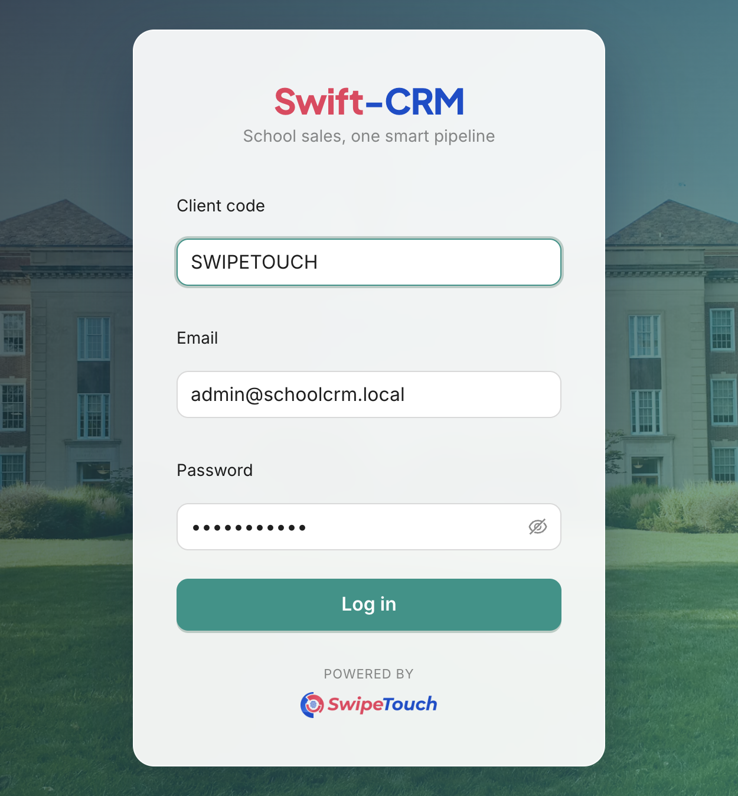
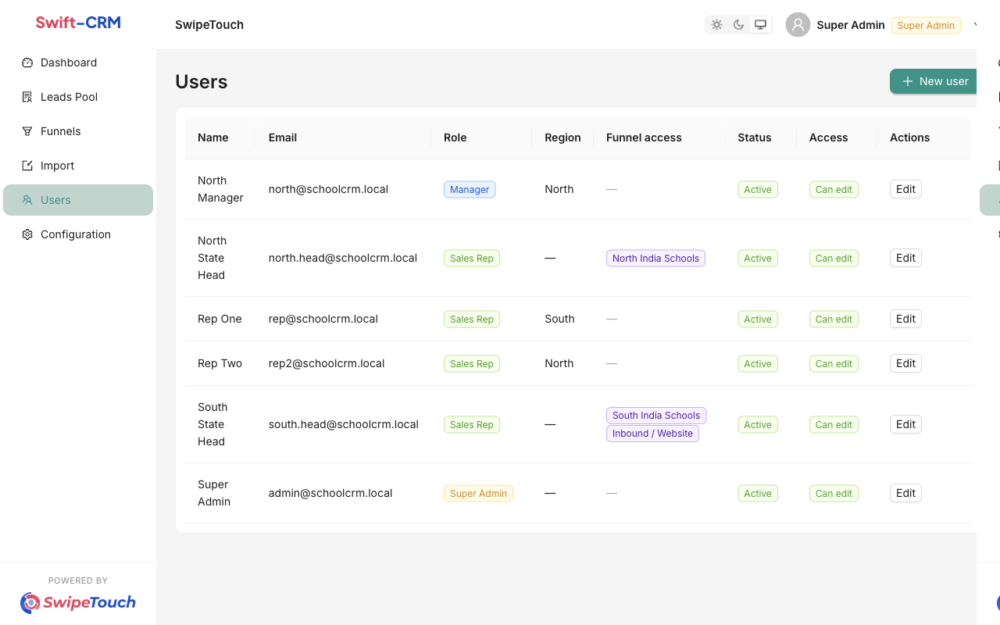
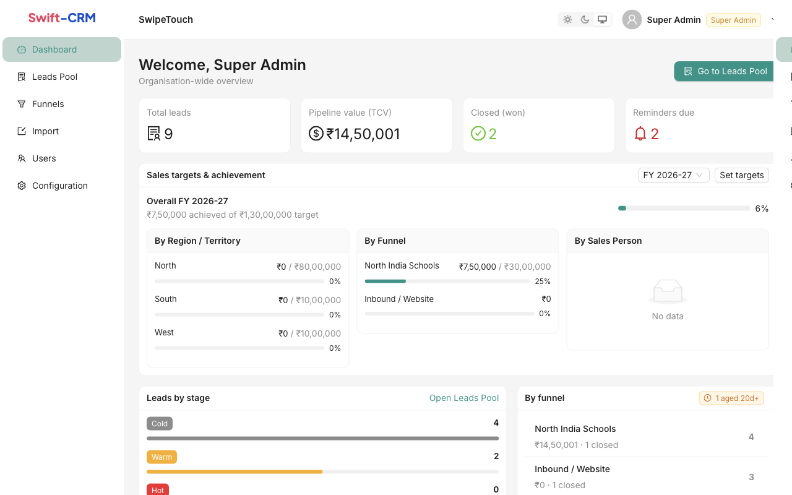
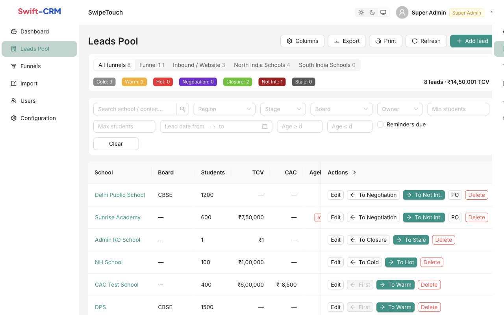
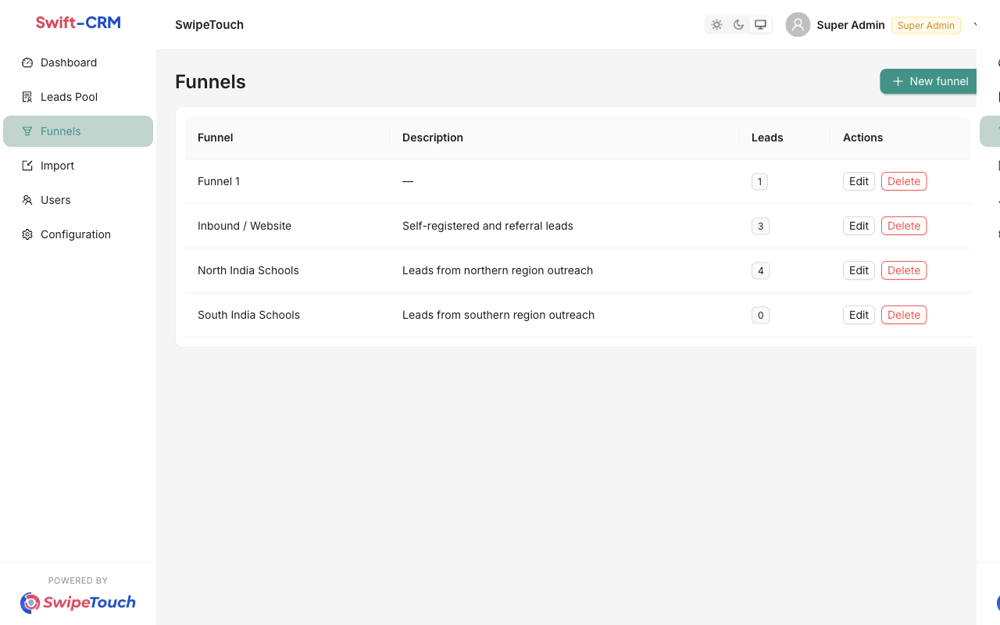
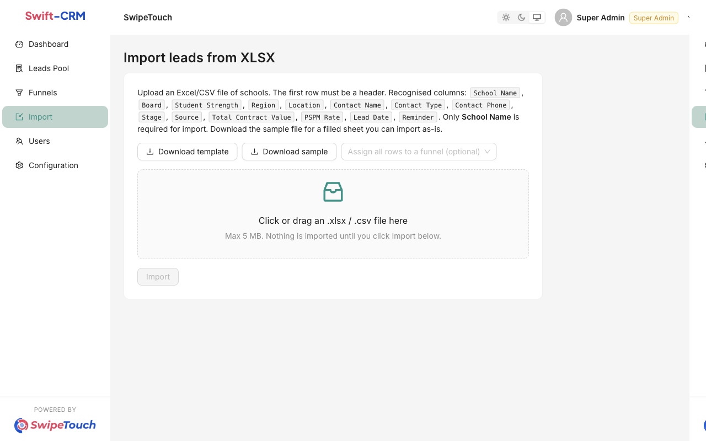

# Swift-CRM for the sales team

Swift-CRM is the shared pipeline for school sales. Every school you are working is a **lead**. A lead sits in a **stage** (Cold, Warm, Hot, and so on) until it is won, lost, or goes quiet. Your job in the product is simple: keep each school up to date, so the next person who opens it knows where the conversation stands.

Your company name appears at the top (for example SwipeTouch). You only ever see your own company’s schools, people, and targets.

## Sign in

Open the app link your manager sent you. Three things get you in:

1. **Client code** — your company’s code, not your email. Type it as given (for example `SWIPETOUCH`).
2. **Email** — the address on your user account.
3. **Password** — the one you were given. Change it after the first login if you were told to.

The sun, moon, and monitor icons at the top right switch light mode, dark mode, or “follow my computer”.

## What you can see

The left menu changes with your role.

| Role | What it is for | What you see |
| --- | --- | --- |
| **Sales rep** | Works their own schools | Dashboard and Leads Pool, only for schools they own or funnels they are assigned |
| **Manager** | Runs a region | Those, plus Funnels, Import, and Users. Leads are limited to their region |
| **Super Admin** | Runs the whole company | Everything, including targets and Configuration |

A sales rep who is also a **state head** is still a sales rep, but they are given one or more funnels (for example North India Schools). They see the schools in those funnels, not the whole country.

If your account says **view-only**, you can look but not add or move schools. A banner on the Leads Pool explains why.

## Start on the Dashboard

This is the morning page. It answers “how is the book looking?” before you open a single school.

Read it like this:

- **Total leads** — schools currently in the pipeline you are allowed to see.
- **Pipeline value (TCV)** — the total contract value of those schools. TCV is the deal size, in rupees.
- **Closed (won)** — schools that have reached Closure.
- **Reminders due** — schools whose follow-up date is today or earlier. If this number is red, those calls are late.
- **Sales targets & achievement** (Super Admin) — this financial year, April to March. Overall, then split by region, funnel, and salesperson. “Set targets” is how the admin records the number you are chasing.
- **Leads by stage** — how many schools sit in Cold, Warm, Hot, Negotiation, Closure, Not Int., and Stale.
- **By funnel** — which list the schools came from, and how many are already closed.
- The orange **aged** tag means schools whose lead date is older than the ageing limit (20 days unless an admin changed it). Old untouched schools need a decision: move them, or mark them Stale / Not Int.

**Recently updated** is the short list of schools someone touched last. Click **Go to Leads Pool** when you are ready to work.

## Work the Leads Pool

This is where the day is spent.

Across the top, the **funnel switcher** is your lists: All funnels, North India Schools, Inbound / Website, and so on. The coloured tags under it are a headcount by stage for the list you picked. The figure on the right is how many schools, and their combined TCV.

### Find a school

Use the filters instead of scrolling:

- Search matches school name, contact, or location.
- Region, stage, board, and (for managers) owner.
- Student strength, lead-date range, and age in days.
- **Reminders due** shows only schools you should follow up now.

**Clear** resets the filters. **Columns** shows or hides extra fields. **Export** and **Print** appear only if your account is allowed to take data out.

### One row is one school

Click the school name to open the full record: board, students, contact (Influencer or School Promoter), phone, funnel, owner, value, reminder, and the history of every stage change.

On the row itself:

- **Edit** updates the details. Set a **reminder date** when you agree to call back. When that day arrives, the school shows up under Reminders due. A short reminder note (“principal asked for the PSPM quote”) saves the next person from guessing.
- The arrow buttons move the stage. The green one moves **forward** (Cold → Warm → Hot → Negotiation → Closure). Managers and admins also get a back arrow. Sales reps can only move a school forward.
- Each move can take a note (“met the promoter, wants a pilot in April”). That note is stored in the history.
- **PO** is the purchase order. It matters once the school is in Closure.
- **Delete** removes the school. Use it only for a duplicate or a mistake.

**PSPM** is the per-student-per-month rate. **CAC** is what it cost to win the school. Fill them in when you know them; they are not required to save a lead.

### Add a school by hand

**Add lead** asks for the school name first. Everything else can wait, but the useful record has: board, student strength, region, city, contact name, whether they are an Influencer or a School Promoter, phone, funnel, owner, TCV, and a lead date. The lead date is what ageing is counted from, so use the day you actually started the conversation, not today’s date if the school is already old.

## When the school says yes

Move the school to **Closure**. That is the won stage. The app then asks for a **purchase order**: PO number, deal date, contract end, PSPM or lump sum, GST, billing cycle, and who the letter is addressed to (Principal, Director, Promoter, Chairman).

Save the PO, then download it as PDF or Word. The letter uses your company’s logo and template, which the Super Admin maintains under Configuration.

Closure is final for everyone except a Super Admin. If a deal falls through after it was marked won, ask an admin to move it back. Do not create a second lead for the same school.

**Not Int.** means they declined. **Stale** means it went quiet. Both are better than leaving a dead school in Hot, because Hot is what the team treats as live.

## Funnels

A funnel is a source list, not a stage. “North India Schools” and “Inbound / Website” are funnels. Cold and Warm are stages. A school has one funnel and one stage.

Managers and Super Admins create funnels from this page. Deleting a funnel does **not** delete its schools. They stay in the Leads Pool, just unassigned, until someone files them under another list.

## Bring in a spreadsheet

Use **Import** when a fair or a partner has given you a sheet of schools, instead of typing them one by one.

1. **Download sample** if you want a filled example, or **Download template** if you only want the header row.
2. Keep the header row. The only required column is **School Name**. Useful columns are Board, Student Strength, Region, Location, Contact Name, Contact Type (Promoter or Influencer), Contact Phone, Stage, Source, Total Contract Value, PSPM Rate, CAC, Lead Date, and Reminder.
3. Optionally pick a funnel so every row in the file lands in that list.
4. Drop the file in, then click **Import**. Nothing is saved until that click. The page tells you how many schools were created and which rows were skipped, with the reason.

## A normal morning

1. Sign in and look at **Reminders due** and the aged-schools tag.
2. Open the Leads Pool, tick **Reminders due**, and clear those calls. Update the stage or set the next reminder before you leave the row.
3. Switch to your funnel and scan Hot and Negotiation. Those are the schools closest to a PO.
4. Add anything new from yesterday’s visits, or import the sheet if it is a long list.
5. When a school agrees, move it to Closure and complete the purchase order the same day. The target on the dashboard only counts schools closed inside the financial year.
